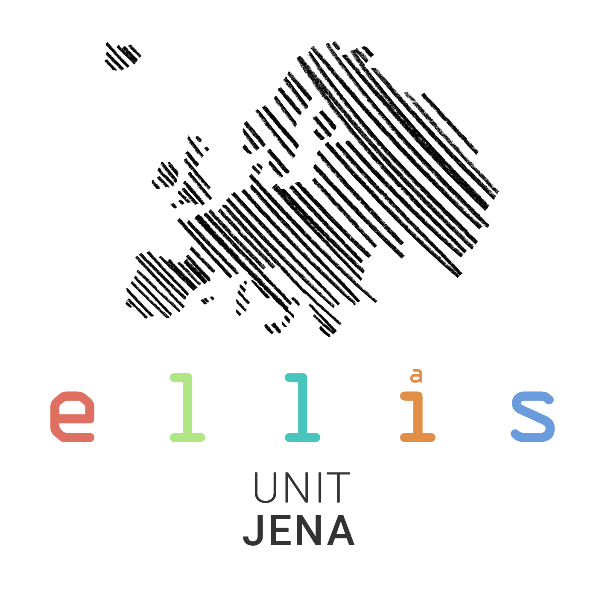


<figure class="mlcn-banner">
  
  <figcaption>MICCAI {{ w.year }} workshop{{ w.city | split: ',' | first }} {{ w.year }}</figcaption>
</figure>

<h1>MLCN {{ w.year }}: Machine Learning in Clinical Neuroimaging</h1>

MICCAI {{ w.year }} · {{ w.city }} · {{ w.conference_dates }}

In this international workshop on <b><i>Machine Learning in Clinical Neuroimaging</i></b> we bring together researchers in machine learning, neuroscience and tech-savvy clinicians to develop methods for complex neuroimaging data and to close the gap between those methods and clinical practice.


We are preparing MLCN {{ w.year }}.The call for papers, deadlines and keynote speakers follow the MICCAI {{ w.year }} workshop timeline. Workshop day: {{ w.workshop_date }}.

Submissions for MLCN {{ w.year }} are open.Workshop day: {{ w.workshop_date }}.


  <a class="mlcn-button" href="{{ w.openreview }}/submission_registration/">Submit on OpenReviewCall for papers</a>
  <a class="mlcn-button secondary" href="{{ w.last.program }}">MLCN {{ w.last.year }} program</a>

  <a class="mlcn-card" href="/submission_registration/"><svg viewBox="0 0 24 24"><path d="M14 3H7a2 2 0 0 0-2 2v14a2 2 0 0 0 2 2h10a2 2 0 0 0 2-2V8z"/><path d="M14 3v5h5"/><path d="M9 13h6M9 17h4"/></svg><strong>Call for papers</strong>Submissions openTwo tracks, opening soon<svg class="go" viewBox="0 0 24 24" aria-hidden="true"><path d="M9 6l6 6-6 6"/></svg></a>
  <a class="mlcn-card" href="/keynotes/"><svg viewBox="0 0 24 24"><rect x="9" y="3" width="6" height="11" rx="3"/><path d="M5 11a7 7 0 0 0 14 0"/><path d="M12 18v3M9 21h6"/></svg><strong>Keynotes</strong>Two invited talksTwo invited talks, announced soon<svg class="go" viewBox="0 0 24 24" aria-hidden="true"><path d="M9 6l6 6-6 6"/></svg></a>
  <a class="mlcn-card" href="/program/"><svg viewBox="0 0 24 24"><rect x="3" y="5" width="18" height="16" rx="2"/><path d="M3 10h18M8 3v4M16 3v4"/><path d="M7 14h3M7 17.5h6"/></svg><strong>Program</strong>Orals, lightning talks and posters<svg class="go" viewBox="0 0 24 24" aria-hidden="true"><path d="M9 6l6 6-6 6"/></svg></a>
  <a class="mlcn-card" href="/community_organizers/"><svg viewBox="0 0 24 24"><circle cx="9" cy="8" r="3.2"/><path d="M3 20c0-3.3 2.7-6 6-6s6 2.7 6 6"/><circle cx="17.5" cy="9.5" r="2.5"/><path d="M16 14.3c3 .1 5 2.3 5 5.2"/></svg><strong>Community</strong>Organizers and past editions since 2018<svg class="go" viewBox="0 0 24 24" aria-hidden="true"><path d="M9 6l6 6-6 6"/></svg></a>

<h2>Key dates</h2>

<strong>{{ d.label }}</strong>{{ d.date }}


<strong>Workshop</strong>{{ w.workshop_date }}

<h2>Sponsors</h2>

  
  
  

<h2>Frequently asked questions</h2>

<details open>
{{ q.q }}

{{ q.a }}



Papers from previous years are in the <a href="{{ w.proceedings }}">MLCN proceedings</a>; some talks are on our <a href="{{ w.youtube }}">YouTube channel</a>.

